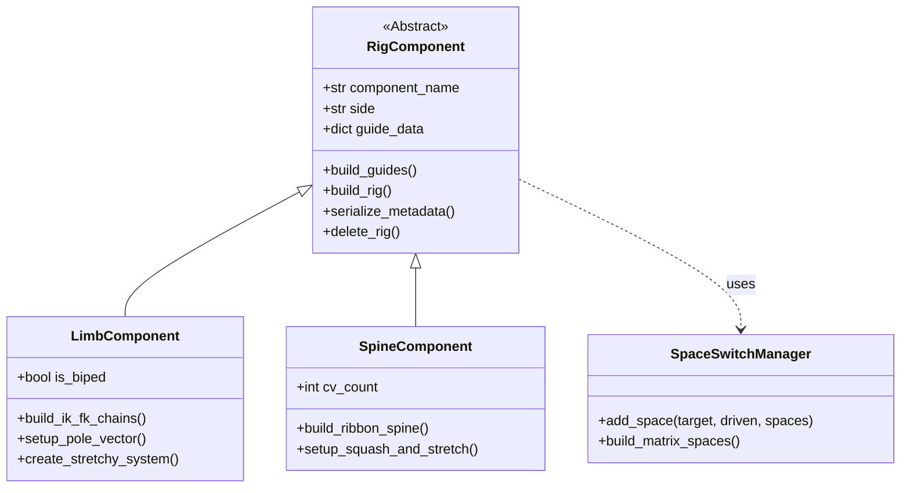
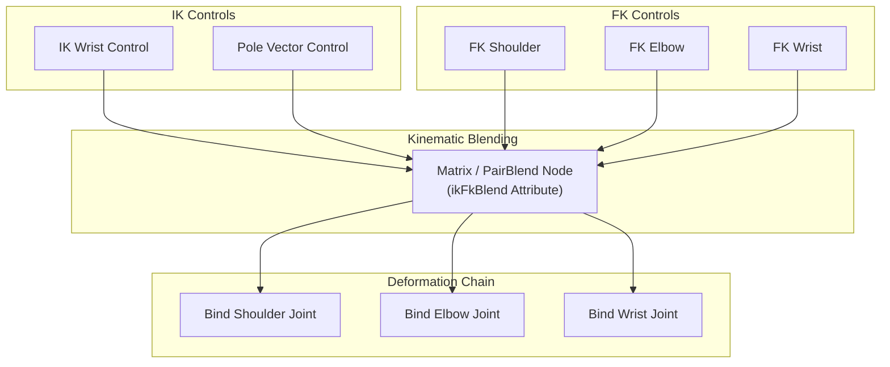

# Modular Custom Auto-Rigger

A scalable, component-based auto-rigging framework built for Autodesk Maya. Developed to streamline character, creature, and mechanical rig construction across studio production pipelines.

---

## 🎯 Overview & Philosophy

Modern animation pipelines demand modularity, deterministic builds, and robust control over rig components. This framework decouples the rigging process into three distinct phases:

1. **Guide / Template Phase:** Artists position interactive guide locators with visual constraints (plane alignment, length display).
2. **Build Phase:** Components instantiate programmatically from standardized base classes, establishing control hierarchies, space-switches, and deformation chains.
3. **Finalize Phase:** Skinning weights import, control shapes deserialize from JSON libraries, and validation suites run prior to animation hand-off.

---

## 🏗 Modular Architecture

Each rig module inherits from an abstract base class (`RigComponent`), ensuring uniform APIs for building, serializing, and matching controls.

---

## 🦾 IK / FK 3-Chain System & Matching

The limb architecture employs an industry-standard **3-chain system**:
- **FK Chain:** Driven by dedicated FK control hierarchies.
- **IK Chain:** Driven by solver handles (`ikRPsolver` / `ikSCsolver`) and Pole Vector controls.
- **Bind / Result Chain:** Blended dynamically between IK and FK using matrix blending or pairBlend nodes, driving skinning joints.

### Seamless IK/FK Matching Logic
To allow animators to switch between kinematic modes without spatial snapping, matching math runs at switch time:

- **FK $\to$ IK:** The IK wrist effector is aligned to the FK wrist transform; the Pole Vector is projected along the triangle normal formed by Shoulder, Elbow, and Wrist.
- **IK $\to$ FK:** FK bone rotations are computed from the current IK joint angles to align each FK control precisely to the visible pose.

---

## ⚙ Pipeline Features

- **JSON Data Serialization:** Complete rig template states and curve shapes are saved as lightweight JSON files for cross-scene reuse and version tracking.
- **Message Attribute Rig Tagging:** Rigs query connections dynamically via Maya `message` attributes rather than relying on brittle string searches or naming dependencies.
- **Undo Chunk Safety:** Every build operation wraps inside `cmds.undoInfo(openChunk=True)` blocks, guaranteeing clean single-stroke undos.

---

## 💻 Technical Sample

A representative sample of the vector math utilized for IK/FK vector alignment is provided in [`samples/ik_fk_matching.py`](samples/ik_fk_matching.py).

- Demonstrates 3D vector calculations for shoulder aim and elbow plane normal extraction.
- Standalone vector normalization and cross-product math.
