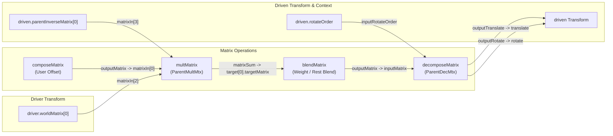
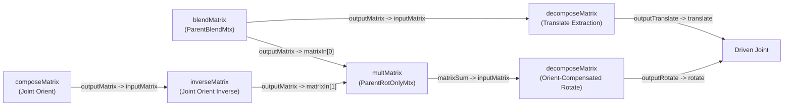

# Matrix Constraints Engine

A lightweight, high-performance matrix-based constraint system for Autodesk Maya. Designed to eliminate evaluation bottlenecks, avoid cycle dependencies, and replace legacy Maya constraint nodes using native matrix math and DG connections.

> [!NOTE]
> **Production Repository:**  
> The complete toolset, full PySide UI, and automated Node Editor bookmark integration are developed in the private repository [`HugoQ-dev/constrain-mtx`](https://github.com/HugoQ-dev/constrain-mtx). Access can be provided to recruiters and technical directors upon request.


---

## 🎯 Overview & Purpose

Legacy Maya constraint nodes (`parentConstraint`, `pointConstraint`, etc.) introduce unnecessary Dependency Graph (DG) complexity, pairBlend clutter, and potential cycle evaluation warnings in complex rigs.

This tool builds constraints dynamically using native matrix operations (`multMatrix`, `decomposeMatrix`, or Maya's `offsetParentMatrix`), drastically reducing node count and ensuring optimal performance under Maya's Parallel Evaluation and GPU deformer engines.

---

## ✨ Key Features

- **Constraint Types Supported:**
  - **Transform (Parent):** Drives translate, rotate, and scale via `multMatrix` and `decomposeMatrix`.
  - **Translate Only (Point):** Isolated translation extraction.
  - **Rotate Only (Orient):** Isolated rotation extraction.
  - **Scale Only:** Dedicated matrix scaling connection.
  - **Aim & Look-At:** Vector math computed through matrix construction.
  - **Pole Vector:** Directional vector mapping to joint rotate plane.
- **Maintain Offset Preservation:**
  - Automatically computes the initial relative offset via inverted matrix multiplication:
    $$\text{Offset} = \text{DrivenWorldMatrix} \times \text{DriverWorldInverseMatrix}$$
- **Cycle-Free Architecture:** Eliminates cyclic dependency issues frequently seen in space switching and complex rig hierarchies.
- **Modern Maya Ready:** Full support for `offsetParentMatrix` (OPM) integration to maintain completely zeroed transform channels.

---

## 📊 Technical Comparison & Benchmark

| Feature | Legacy Maya Constraints | Matrix Constraints Engine |
| :--- | :--- | :--- |
| **Node Count per Target** | 1 heavy constraint node + blends | 1 `multMatrix` + 1 `decomposeMatrix` |
| **Transform Channels** | Locked or polluted with blend values | Clean, zeroed or directly driven via OPM |
| **Graph Evaluation** | Serial bottlenecks common | Optimized for Maya Parallel Evaluation |
| **Maintain Offset** | Opaque internal calculation | Explicit, mathematical matrix inversion |
| **Joint Compatibility** | Complex offset groups needed | Dedicated `jointOrient` matrix compensation |

---

## 🧠 Mathematical Architecture

To maintain the driven object's position relative to the driver without manual grouping or pops, the relative transformation matrix is computed at build time:

```text
[Driven World] = [Driver World] * [Driven Local Offset]
=> [Driven Local Offset] = [Driven World] * [Driver World Inverse]
```

When evaluating inside Maya's Dependency Graph, the evaluated local matrix for the driven transform is reconstructed as:

$$\mathbf{M}_{\text{eval}} = \mathbf{M}_{\text{userOffset}} \times \mathbf{M}_{\text{restOffset}} \times \mathbf{M}_{\text{driver.worldMatrix}} \times \mathbf{M}_{\text{driven.parentInverseMatrix}}$$

---

## 📐 Dependency Graph (DG) Architecture

### 1. Standard Transform Network
For standard transforms, the calculated matrix chain feeds into a `blendMatrix` for smooth blending before final decomposition:



### 2. Joint Orient Compensation Network
Maya joints evaluate orientation by cascading `jointOrient`, `rotate`, and `rotateAxis`:

$$\mathbf{R}_{\text{final}} = \mathbf{O}_{\text{jointOrient}} \times \mathbf{R}_{\text{transform}} \times \mathbf{R}_{\text{rotateAxis}}$$

To prevent joint flipping and rotational drift when constraining joints, the `jointOrient` matrix is inverted and multiplied into the rotation stream prior to decomposition:



---

## ⚡ Performance Breakdown: Parallel Evaluation

Maya's **Parallel Evaluation (PE)** and **Evaluation Toolkit** benefit significantly from matrix-based setups over legacy constraints:

1. **Cycle-Free DAG Scheduling:** Legacy constraints often generate cycle warnings when participating in space-switching or two-way control rigs due to the constraint node's bidirectional queries. Matrix networks are purely feed-forward, DAG-safe, and thread-friendly.
2. **Minimal Dirty Propagation:** Instead of triggering dirty flag cascades across complex transform hierarchies and pairBlend nodes, matrix nodes isolate dirty propagation strictly along single attribute plugs.
3. **GPU Deformer Ready:** Zeroed transforms using `offsetParentMatrix` (OPM) avoid CPU transform overhead entirely, passing matrices directly to the GPU deformation pipeline.

---

## 💻 Technical Sample

A representative sample of the underlying matrix logic is provided in [`samples/matrix_math.py`](samples/matrix_math.py).

- Demonstrates relative offset computation ($M_{\text{driven}} \times M_{\text{driver}}^{-1}$).
- Pure 4x4 matrix multiplication and inversion logic for verification outside Maya.
- Follows PEP 8 guidelines and explicit modular structuring.
