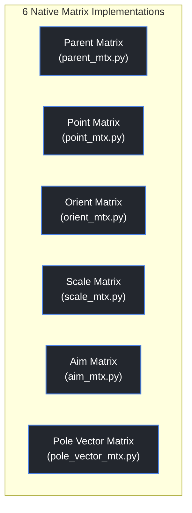
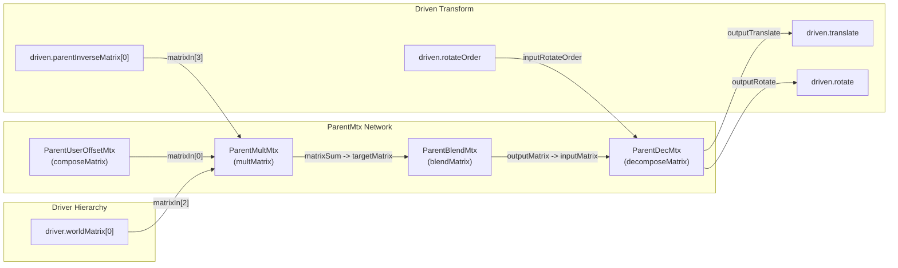
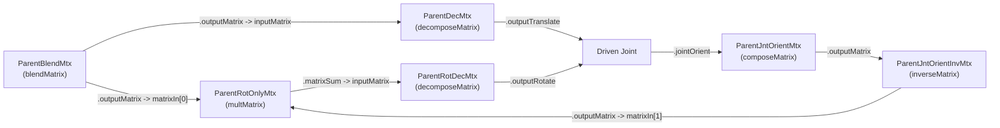

# Matrix Constraints Engine

A modular, production-grade matrix constraint toolkit for Autodesk Maya that replaces legacy constraint nodes with high-performance Dependency Graph (DG) networks. Built with **Maya API 2.0 (`OpenMaya`)** and native matrix nodes, it delivers full parity with Maya constraints while providing cycle-free evaluation, clean parallel execution, and automated workflow tooling.

> [!NOTE]
> **Source Repository & Code Review:**  
> The complete production framework, full PySide/Maya UI, automated Node Editor layout engine, and unit test suites are maintained in the private repository [`HugoQ-dev/constrain-mtx`](https://github.com/HugoQ-dev/constrain-mtx). Full source access is available upon request for recruiters, pipeline leads, and technical directors.


---

## 🎯 Architecture Overview & Why Matrix Constraints?

Legacy Maya constraint nodes (`parentConstraint`, `orientConstraint`, `aimConstraint`, etc.) were introduced in Maya's early DAG architecture. In modern studio production, they introduce significant technical drawbacks:

| Architectural Challenge | Legacy Maya Constraints | Matrix Constraints Engine (`constrain-mtx`) |
| :--- | :--- | :--- |
| **DG Evaluation Model** | Opaque multi-pass solver nodes with internal caches | Native single-pass DG matrix operations (`multMatrix`, `blendMatrix`, `decomposeMatrix`) |
| **Parallel Evaluation (PE)** | Frequent cycle warnings and thread sync bottlenecks | Pure feed-forward DAG streams; fully thread-safe for Maya Parallel Evaluation |
| **Transform Channel Clutter** | Injects heavy `pairBlend` networks when keyframed | Direct driving into channels or native `offsetParentMatrix` (OPM) integration |
| **Maintain Offset** | Opaque internal coordinate caching | Explicit matrix inversion math ($M_{\text{offset}} = M_{\text{driven}} \times M_{\text{driver}}^{-1}$) |
| **Joint Skeletal Chains** | Requires extra zero/orient groups to prevent flipping | Dedicated inverted `jointOrient` matrix math compensation |
| **Graph Cleanliness** | Clutters the Node Editor with unordered connections | Automated 2D columnar layout and registered Node Editor bookmarks |
| **Outliner Legibility** | Displays standard constraint child nodes | Optional non-intrusive `dagContainer` indicators exposing real-time Channel Box parameters |

---

## 📐 Supported Constraint Networks & DG Topologies

The toolkit provides 6 specialized matrix constraint generators matching and extending native Maya constraint capabilities:



---

### 1. Parent Matrix Network (`parent_mtx.py`)

Drives translation and rotation channels with full maintain-offset preservation, per-axis toggling, dynamic weight blending, and joint-orient compensation.

#### Mathematical Foundation
To preserve the initial transform delta between driver and driven without spatial popping:
$$\mathbf{M}_{\text{restOffset}} = \mathbf{M}_{\text{driven.worldMatrix}} \times \mathbf{M}_{\text{driver.worldInverseMatrix}}$$

During graph evaluation, the local target transform is evaluated as:
$$\mathbf{M}_{\text{eval}} = \mathbf{M}_{\text{userOffset}} \times \mathbf{M}_{\text{restOffset}} \times \mathbf{M}_{\text{driver.worldMatrix}} \times \mathbf{M}_{\text{driven.parentInverseMatrix}}$$

#### Standard Transform Topology



#### Skeletal Joint Compensation
Maya evaluates final joint rotation as $\mathbf{R}_{\text{final}} = \mathbf{O}_{\text{jointOrient}} \times \mathbf{R}_{\text{transform}} \times \mathbf{R}_{\text{rotateAxis}}$. When constraining joints, driving `.rotate` directly introduces orientation skew. The engine detects joint nodes automatically and routes rotation through a cancellation sub-branch:

$$\mathbf{M}_{\text{rotOnly}} = \mathbf{M}_{\text{blendOutput}} \times \mathbf{M}_{\text{jointOrient}}^{-1}$$



---

### 2. Point Matrix Network (`point_mtx.py`)

Reproduces native `pointConstraint` with precise driver rotate pivot handling and local parent coordinate conversion.

- **Driver Pivot Query:** If `use_driver_pivot=True`, transforms the driver's `.rotatePivot` via `pointMatrixMult` (or `pointMatrixMultDL` on Maya 2026+) to ensure off-center pivots drive target positions accurately.
- **Maintain Offset & User Delta:** Computes world rest translation delta and feeds it alongside interactive user offsets into a `plusMinusAverage` (`PointOffsetSum_`) and `composeMatrix` before multiplying into local space.
- **Blending:** Feeds into `blendMatrix` (`PointBlendMtx_`) with `rotateWeight=0`, `scaleWeight=0`, and `shearWeight=0`, isolating translation before decomposing into `driven.translate`.

---

### 3. Orient Matrix Network (`orient_mtx.py`)

Extracts pure rotation while stripping scale and shear distortion.

- **Rotation Isolation:** Uses Maya's native `pickMatrix` (`OrientPickMtx_`, `useRotate=1`, `useTranslate=0`, `useScale=0`, `useShear=0`) ensuring downstream rotation evaluation remains clean even if the driver is non-uniformly scaled.
- **Quaternion/Euler Rest Offset:** Computes maintain-offset rotation in rest space via Maya API 2.0 quaternions (`om.MTransformationMatrix.rotation().asMatrix()`), correctly accounting for differing `rotateOrder` settings on driver and driven.
- **Joint Orient Neutralization:** Integrates `OrientJntOrientInvMtx_` to cancel skeletal joint orientations when driven is a Maya joint.

---

### 4. Scale Matrix Network (`scale_mtx.py`)

Reproduces native `scaleConstraint` with multiplicative offset math.

- **Scale Isolation:** Isolate scale channels via `pickMatrix` (`ScalePickMtx_`, `useScale=1`).
- **Multiplicative Offset:** Unlike translation offsets (which are additive), scale offsets are multiplicative. The engine calculates initial rest ratios ($\text{Scale}_{\text{rest}} / \text{Scale}_{\text{driver}}$) and feeds them into a `multiplyDivide` node (`ScaleOffsetMultPMA_`, `operation=Multiply`) with safety checks against division-by-zero.
- **Channel Blending:** Blends local scale against the rest local scale via `blendMatrix` (`scaleWeight=1.0`).

---

### 5. Aim Matrix Network (`aim_mtx.py`)

Leverages Maya's native `aimMatrix` node to eliminate old legacy `aimConstraint` node evaluation issues.

#### World Up Type Parity
The engine reproduces all 5 native Maya Aim World Up calculation models:

| World Up Type | `aimMatrix.secondaryMode` | Vector / Target Configuration |
| :--- | :---: | :--- |
| **Scene Up** | `2` (Align) | Aligns secondary axis to Maya's current scene up vector (`cmds.upAxis`, typically `(0, 1, 0)`). |
| **Vector** | `2` (Align) | Aligns secondary axis to an explicit user-defined `world_up_vector`. |
| **Object Up** | `1` (Aim) | Aims secondary axis directly at the world `rotatePivot` of `world_up_object`.<br>*(Crucial bugfix: `secondaryTargetVector` is explicitly reset from Maya's default `(0, 1, 0)` to `(0, 0, 0)` to avoid angular offset drifting).* |
| **Object Rotation Up** | `2` (Align) | Aligns secondary axis with `world_up_vector` rotated by `world_up_object.worldMatrix[0]`. |
| **None** | `0` (None) | Freely rotates without secondary axis alignment constraints. |

---

### 6. Pole Vector Matrix Network (`pole_vector_mtx.py`)

Replaces `poleVectorConstraint` on two-bone IK chains (`ikHandle` with `ikRPsolver`):

1. Automatically queries the IK chain's `startJoint` via the solver connection.
2. Evaluates the world position vector from root joint to target controller:
   $$\vec{\mathbf{V}}_{\text{world}} = \mathbf{P}_{\text{driver}}(\text{RotatePivot}) - \mathbf{P}_{\text{startJoint}}$$
3. Transforms $\vec{\mathbf{V}}_{\text{world}}$ into the `ikHandle`'s parent coordinate space using `pointMatrixMult` with `vectorMultiply=1` (directional vector transformation without translation offset).
4. Blends via `blendColors` (`PVBlend_`) for smooth weighting and connects directly to `ikHandle.poleVector`.

---

## 🛠 Advanced Production Features

### 1. Automated Node Editor 2D Layout & Bookmarks (`bookmark_mtx.py`)
A major friction point with matrix rigging is visual clutter in Maya's Node Editor. `constrain-mtx` features a dedicated graph layout engine:
- **Deterministic 2D Grid:** Automatically places nodes in structured columns ($X$ spacing: `280px`) and sub-rows ($Y$ spacing: `-190px`) to prevent cable crossing.
- **Node Editor Bookmarks:** Registers a bookmark named `<ConstraintType>Mtx_<Driver>_<Driven>` into `MayaNodeEditorBookmarks`.
- **Auto-Framing:** Computes the network's bounding box and sets `viewLow` / `viewHigh` with clean margins (`BM_VIEW_MARGIN_X=260.0`, `BM_VIEW_MARGIN_Y=240.0`), immediately framing the new constraint network when opened.

```text
[Col 0] Driver Transform
   │
[Col 1] User Offset / Local Space Matrix
   │
[Col 2] multMatrix (Local calculation) ──> [Subrow Y] Joint Orient Cancellation
   │                                              │
[Col 3] blendMatrix (Weight Interpolation) <──────┘
   │
[Col 4] decomposeMatrix
   │
[Col 5] Driven Transform
```

### 2. Non-Intrusive Outliner Indicators (`indicator_mtx.py`)
Riggers and animators rely on the Outliner to see which objects are constrained. Rather than using opaque Maya assets or containers that bury the DG graph:
- Instantiates a clean, empty `dagContainer` (or lightweight `transform`) parented directly under the driven object.
- Assigns the native constraint icon (`out_parentConstraint.png`, `out_pointConstraint.png`, etc.) via `.iconName`.
- **Zero Encapsulation:** No nodes are published into the container; the Node Editor graph remains 100% accessible.
- **Channel Box Passthrough:** Exposes standard constraint channels (`<Driver>W0`, `Offset X/Y/Z`) directly on the indicator, wired straight to the underlying `blendMatrix.envelope` and `composeMatrix` inputs for real-time control.
- **Global Toggle:** Studio-wide setting stored via `optionVar` (`ConstraintMtx_UseOutlinerIndicators`) to toggle indicators across scenes with zero overhead.

### 3. Pipeline Safety & Conflict Detection
Before generating any network, validation routines inspect destination plugs:
- **Blocker Detection (`find_*_blockers`):** Inspects incoming connections and locked attributes across target channels (`translate`, `rotate`, `scale`, `poleVector`), reporting explicit conflicts to the rigger before scene modification.
- **Non-Destructive Regeneration:** Automatically detects and cleanly deletes pre-existing `constrain-mtx` networks on the driven object before rebuilding.
- **Undo Chunk Encapsulation:** All creation operations are wrapped in `cmds.undoInfo(openChunk=True)` ensuring clean single-step undo reliability (`Ctrl+Z`).
- **DG Cleanliness:** Sets `.isHistoricallyInteresting = 0` on intermediate math nodes to prevent Channel Box pollution.

---

## 💻 Code Sample

A representative sample of the underlying pure 4x4 matrix multiplication and maintain-offset inversion logic is provided in [`samples/matrix_math.py`](samples/matrix_math.py).

To explore the complete codebase (UI, bookmark layout manager, indicator system, and full matrix solvers), contact [@HugoQ-dev](https://github.com/HugoQ-dev) for access to the private [`HugoQ-dev/constrain-mtx`](https://github.com/HugoQ-dev/constrain-mtx) repository.
