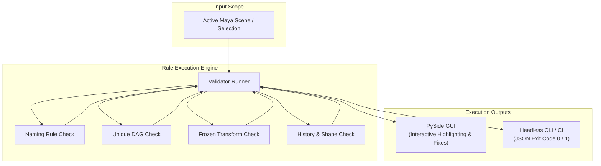

# Scene & Naming Pipeline Validator

A proactive, extensible scene validation tool built for Autodesk Maya. Designed to enforce naming standards, detect DAG hierarchy anomalies, and clean scenes prior to studio publishing and asset hand-off.

---

## 🎯 Overview & Purpose

In production pipelines, scene inconsistencies (non-unique DAG names, improper suffixes, un-frozen transforms, uncleaned construction history) cause critical downstream failures in layout, animation, and rigging caches.

This validator acts as a quality gate, running both interactively inside Maya through a PySide interface and headlessly in batch mode (CI / PyMaya).

---

## 🔍 Validation Checks & Rules Suite

The tool inspects the Maya Dependency Graph and DAG hierarchies across several standardized check suites:

| Category | Verification Checks | Auto-Fix Available |
| :--- | :--- | :---: |
| **Naming Conventions** | Node prefixes/suffixes per category (`jnt_`, `ctrl_`, `grp_`, `geo_`, `loc_`), side identifiers (`_l`, `_r`, `_m`). | ⚠️ Manual Review |
| **DAG Uniqueness** | Detects non-unique DAG object names (multiple nodes sharing the same short name). | ⚠️ Manual Review |
| **Transform Cleanliness** | Verifies zeroed channels on controls, frozen transforms on bind geometries, and neutral scales (`1.0, 1.0, 1.0`). | ✅ Yes |
| **Deformation & History** | Flags non-deformer construction history on skin meshes and orphaned intermediate shape nodes. | ✅ Yes |
| **Display Layers & Namespaces** | Identifies unassigned empty display layers and unresolved namespaces. | ✅ Yes |

---

## 🏗 Architecture & Execution Flow

The engine implements a **Strategy Pattern** where each rule is an isolated validator returning a standardized report item:

---

## 🖥 Modes of Operation

1. **Interactive PySide GUI:**
   - Visual status indicators (Passed / Warning / Critical Error).
   - "Select in Viewport" button to inspect faulty nodes immediately.
   - One-click auto-fix actions for deterministic issues (e.g., delete intermediate shapes, freeze transforms).

2. **Headless Batch / CI Mode:**
   - Runs via standalone Maya Python (`mayapy.exe`) without loading the UI.
   - Generates structured JSON reports for CI validation before asset publishes.

---

## 💻 Technical Sample

A representative sample of the regex-based validation logic is provided in [`samples/validator_engine.py`](samples/validator_engine.py).

- Demonstrates dictionary-driven regex pattern compilation per Maya node type.
- Clean tuple response pattern `(is_valid: bool, message: str)`.
